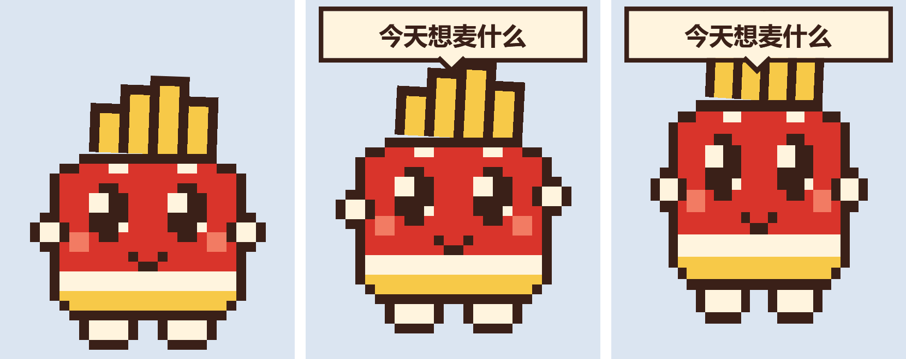

# 小简桌面宠物

180×220 的像素风透明置顶小宠物,放在桌面角落。点一下,启动语进剪贴板,WorkBuddy 被打开或唤起,你只需要 Ctrl+V。

## 启动

双击 `start-pet.cmd`。脚本以 `-ExecutionPolicy Bypass` 启动 `simple-eat-pet.ps1`,无需改系统策略。

- 环境:Windows PowerShell 5.1 + WPF,无需额外安装。
- 单实例:重复双击不会出现第二只。
- 不占任务栏,默认出现在主屏工作区右下角。

## 外观

- 像素风:24×28 网格,每格 6 像素,放大显示,边缘保持锐利。
- 大眼睛:眼睛占脸部比例大,带高光,便于在 180×220 下看清。
- 配件:薯条、手、脚和一颗小爱心。

## 交互

- 鼠标移上去:小跳一下、挥手、换开心脸,并弹出气泡"今天想麦什么"。移开后气泡消失,平时不显示气泡。
- 左键单击:压扁回弹,飘出爱心,复制启动语,打开或激活 WorkBuddy,气泡提示"已复制,去 WorkBuddy 按 Ctrl+V"。
- 按住拖动:移动位置,移动超过 4 像素视为拖动,不会触发点击。
- 右键菜单:打开 WorkBuddy / 复制启动语 / 打开项目目录 / 退出。

## 待机动效

- 呼吸起伏、轻微左右摇摆。
- 随机眨眼、左右张望。
- 偶尔踮脚。

## 配置

默认读取 `config.example.json`。想自定义时,复制为 `config.json` 再修改,`config.json` 优先。非空字段覆盖脚本内置默认值,留空的字段回退到默认值。

- `workbuddyExe`:WorkBuddy 可执行文件路径,默认 `D:\LenovoSoftstore\Install\WorkBuddy\WorkBuddy.exe`。
- `projectPath`:右键"打开项目目录"打开的目录。
- `startPrompt`:点击时复制的启动语。
- `bubbleText`:鼠标悬停时的气泡文字,默认"今天想麦什么"。

## 隐私

- 只在本机读写剪贴板,不联网,不上传任何内容。
- 配置里只放路径和启动语,不要写账号、令牌等敏感信息。
- `pet/config.json` 已加入 `.gitignore`;提交前不要强行 `git add -f`。

## 范围

本目录只包含宠物相关文件,不改动 `skills/`、`scripts/`、`data/`、`docs/` 等核心目录。

## 文件

- `simple-eat-pet.ps1`:宠物主程序
- `start-pet.cmd`:双击启动入口
- `config.example.json`:配置模板
- `assets/pet-pixel-render.png`:待机/悬停/点击三态预览
- `assets/`:静态 SVG/PNG 原稿(矢量时期,未随像素版更新)
- `BRIEF.md`、`STYLE.md`:需求与风格说明